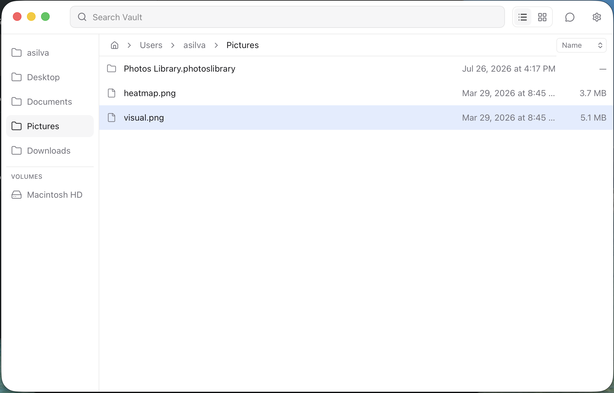
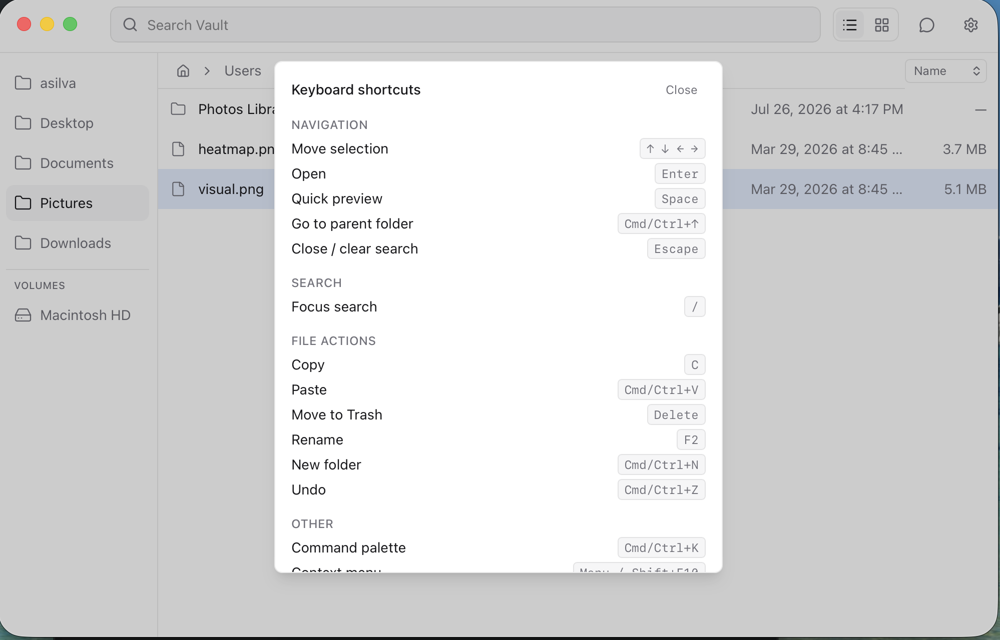
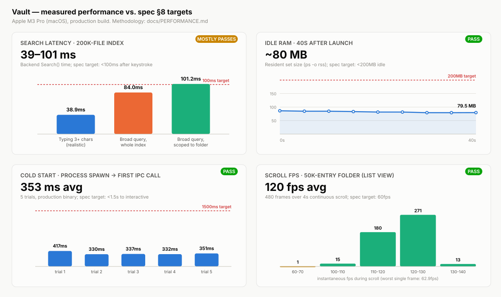

# Vault

A minimal, cross-platform file manager aiming to replace Finder (macOS) and Windows File
Explorer — fast, lightweight, and free of feature bloat.

A file manager that behaves like a command palette, not a filing cabinet: search-first navigation,
zero chrome, keyboard-first, instant everything. Full design spec: [`docs/SPEC.md`](docs/SPEC.md).



## Goals

- Fast startup, low resource usage
- Keyboard-first navigation, full mouse support
- Cross-platform: macOS and Windows at minimum (Linux as a stretch goal)
- Clean, minimal UI — no unnecessary chrome or feature creep
- Feels native on each platform it targets

## Stack

- **Shell:** Wails v3 (Go backend + native webview)
- **Frontend:** React 18 + TypeScript + Tailwind CSS, virtualized lists/grid via TanStack Virtual,
  Zustand for UI state, Shiki for code preview syntax highlighting
- **Search:** Go-side fuzzy matcher (`sahilm/fuzzy`) over an in-memory index of the home
  directory, ranked by match quality → recency → frequency; incremental updates via `fsnotify`
- **Trash:** OS-native trash/recycle-bin per platform adapter — never a permanent delete
- **Thumbnails:** image thumbnails decoded/resized/cached on disk by a bounded Go worker pool

## Architecture

```
main.go                    Wails app entry: window, theming, service registration
cmd/vault-mcp/              MCP server entry point (Claude Desktop / Cursor / MCP clients)
internal/core/             platform-neutral: dir listing, file ops, search index, frecency,
                            fsnotify watchers, thumbnail generation — no OS-specific APIs
internal/platform/          NewTrasher() build-tag dispatch shared by main.go and cmd/vault-mcp
internal/platform/darwin/  macOS adapter: Trash (~/.Trash)
internal/platform/windows/ Windows adapter: Recycle Bin (SHFileOperationW) — cross-compiles
                            clean but is unverified at runtime (no Windows box in dev/CI here)
internal/service/          thin Wails-bound services (Files, Search, Pinned) exposed to the
                            frontend; call only into internal/core
internal/mcp/               MCP tool server (9 tools) wrapping internal/core for cmd/vault-mcp
frontend/                  React + TypeScript + Tailwind UI; talks to internal/service via
                            generated Wails bindings (frontend/bindings/); lib/chatTools.ts +
                            lib/llmClient.ts + components/ChatPanel.tsx are the embedded
                            AI assistant, calling the same lib/vault.ts operations
```

See [`.cursor/rules/architecture.mdc`](.cursor/rules/architecture.mdc) for the full boundary
rules (core stays UI-agnostic; OS-specific behavior stays in one adapter per OS).

## Keyboard map



| Key | Action |
|-----|--------|
| Type anywhere | Search (top bar is always focused on launch) |
| `Esc` | Clear search, return to Home |
| `↑` `↓` | Move selection in a list/search results |
| `←` `→` `↑` `↓` | Move selection in grid view |
| `Enter` | Open selection |
| `Cmd/Ctrl` + `Enter` (in search) | Reveal result's folder in-app |
| `Cmd/Ctrl` + `↑` | Go to parent folder |
| `Space` | Quick preview (image/video/audio/PDF/text/code) |
| `←` `→` `↑` `↓` (preview open) | Move to previous/next file |
| `Cmd/Ctrl` + `K` | Command palette |
| `F2` | Rename selection |
| `Cmd/Ctrl` + `N` | New folder |
| `Cmd/Ctrl` + `C` (via palette "Copy") / `Cmd/Ctrl` + `V` | Copy / paste |
| `Cmd/Ctrl` + `Z` | Undo (rename/move only) |
| Drag file/folder onto the pinned rail | Pin it; drag within the rail to reorder |

## Non-goals (MVP)

No tabs, split panes, cloud integrations, network drives, bulk metadata editing, a general
third-party plugin system, or file tagging. See `docs/SPEC.md` §7 for the full list — this does
not exclude the AI integration described below, which is a defined, first-party feature.

## AI Integration

Vault exposes the same 9 file operations (list directory, search, read file, move, rename,
paste-into, new folder, trash, list pinned) two ways — see `docs/SPEC.md` §10 for the design
rationale:

### MCP server (Claude Desktop, Cursor, and other MCP clients)

```sh
make mcp-build                    # builds bin/vault-mcp
./bin/vault-mcp --root ~/Projects # optional: restrict to a directory (defaults to $HOME)
./bin/vault-mcp --http :8090      # optional: serve over streamable HTTP instead of stdio
```

Add it to **Claude Desktop**'s `claude_desktop_config.json`:

```json
{
  "mcpServers": {
    "vault": {
      "command": "/absolute/path/to/bin/vault-mcp"
    }
  }
}
```

Or to **Cursor**'s `.cursor/mcp.json` (project-level) or `~/.cursor/mcp.json` (global):

```json
{
  "mcpServers": {
    "vault": {
      "command": "/absolute/path/to/bin/vault-mcp"
    }
  }
}
```

File operations are confined to `--root` (default `$HOME`) — a path outside it is rejected.
Deletion always goes to the OS trash, never a permanent delete.

### Embedded chat panel

Click the assistant icon in the top bar, then set a provider (Claude or ChatGPT) and API key in
Settings. The key is stored locally in the browser's `localStorage` — see `docs/STATUS.md` for the
plaintext-storage caveat.

## Performance

Measured against the four targets in `docs/SPEC.md` §8 — cold start, search latency at 200k
files, scroll at 50k entries, idle RAM — on an Apple M3 Pro, production build:



Three of four comfortably clear their target; search latency mostly does, with one worst-case
gap (a broad query, scoped to a folder, matching every entry) — see
[`docs/PERFORMANCE.md`](docs/PERFORMANCE.md) for the full numbers, the caveat, and exactly how
each figure was produced (all reproducible: a committed Go benchmark plus three manual
procedures).

## Status

All ten build-order steps (including AI integration) are implemented and validated. See
[`docs/STATUS.md`](docs/STATUS.md) for the checklist and a list of known limitations (Windows
runtime verification, video thumbnails, "Open With…", `.msi` packaging, chat API key storage).

## Development

- Design spec and non-goals: [`docs/SPEC.md`](docs/SPEC.md)
- Coding conventions and workflow live in `.cursor/rules/` (TDD, core/UI/platform-adapter
  boundaries, commit discipline, response style)
- Commits are prepared by AI tooling but always reviewed and executed by a human
  (`.cursor/rules/git-commits.mdc`)

### Setup

```sh
go install github.com/wailsapp/wails/v3/cmd/wails3@v3.0.0-alpha2.117  # once, if wails3 isn't on PATH
cd frontend && npm install && cd ..
```

### Run

```sh
wails3 dev                       # dev mode, hot reload
wails3 build && ./bin/vault      # production build, run directly
```

### Package

```sh
wails3 package                   # bin/vault.app (ad-hoc signed)
wails3 task package:dmg          # bin/vault.dmg (macOS only, via hdiutil)
wails3 task windows:package GOOS=windows   # NSIS .exe installer (cross-compiled; see docs/STATUS.md)
```

### Test

```sh
go build ./...
go vet ./...
go test -race -cover ./...        # internal/core, internal/mcp, internal/service, internal/platform/darwin
GOOS=windows go build ./... && GOOS=windows go vet ./...   # windows adapter compile check

cd frontend
npx tsc --noEmit
npx vitest run
npm run build
```

`golangci-lint` isn't installed in this environment; run `golangci-lint run` if you have it
available locally.

## License

TBD
